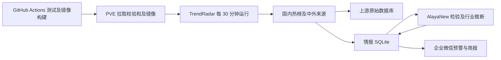

# TrendRadar 全球事件与 A 股行业情报

## 背景与方案概述

目标是在 PVE 以半小时为周期收集国内外资讯，及时提醒证据充分的重大事件，并汇总其他重点事件。趋势与影响分数用于筛选，交易和公司层面的数据验证留到后续阶段。

| 上游能力 | 处理 |
|---|---|
| RSS、热榜、原始 SQLite、Docker cron、渠道发送器 | 复用 |
| RSS 列表、模型地址、周期、阈值和渠道 | 通过配置扩展 |
| 目标源代理、官方 HTML 列表、来源状态 | 增加适配并沿用原生抓取器 |
| 跨语言事件、版本、行业推断、投递任务 | 独立 SQLite 和情报模块 |

上游 AI 支持批量分类、翻译和推送摘要。原有 RSS 索引按源和 URL/GUID 去重，原有推送记录按时段保存；事件和渠道投递需要跨天的状态。部署复用明利项目以镜像标识验证、健康检查和失败回退的做法。RSS 和正式公开政策页优先，Reuters、AP、FT 等待验证合规索引或授权接口。



## PVE 运行

在独立 Ubuntu 24.04 虚拟机安装 Docker、Compose v2、jq 和 curl。将 `deploy/pve/update.sh` 安装为 `/opt/trendradar/update.sh`，把示例环境文件安装为同目录内权限 0600 的 `runtime.env`。将两份 systemd 单元安装到 `/etc/systemd/system/` 并执行 `systemctl daemon-reload` 和 `systemctl enable --now trendradar-update.timer`。

`runtime.env` 配置 `AI_API_BASE`、`AI_MODEL`、`AI_API_KEY` 和 `MARKET_WEWORK_WEBHOOK_URL`。通过 `MARKET_ANALYSIS_ENABLED` 和 `MARKET_NOTIFICATION_ENABLED` 分别启用。覆盖海外代理可设 `MARKET_INTERNATIONAL_PROXY`。只配海外代理时国内官方源仍直连。周期通过 `CRON_SCHEDULE` 调整。评分阈值、简报和分析额度在 `config/config.yaml` 的 `market_intelligence` 段配置，更新默认配置后由镜像发布生效。

```text
cd /opt/trendradar
sudo docker compose --env-file image.env exec -T trendradar python -m market_intelligence check-sources
sudo docker compose --env-file image.env exec -T trendradar python -m market_intelligence health
sudo docker compose --env-file image.env logs --since 1h trendradar
sudo journalctl -u trendradar-update.service
```

定时简报默认北京时间 21:30，最多 8 条。紧急提醒要求近 24 小时的官方报道并通过模型证据校验。只有标题的官方索引缺少精确发布时间时可进入简报，紧急提醒保持关闭。分数与出处写入 SQLite。若企微已接受请求后进程在落库前中断，机器人接口没有幂等键，此极短窗口可导致重发。

## 升级、回退与检查

同一时点只运行一个部署实例。下载慢时，可为更新器的 systemd 单元单独配置 HTTPS_PROXY。首次部署已有相同归档时，可将其以权限 0600 放入 `/opt/trendradar/release-cache/<Release 标签>.tar.gz`，更新器以 GitHub Release 的 SHA-256 核对后复用。发布脚本只应用当前版本的后继提交，校验归档 SHA-256 与 Docker 镜像 ID，停止写入后备份配置和完整 SQLite 目录。保留当前和上一版镜像，以及最近五份且不超过 30 天的发布备份。失败恢复旧镜像和升级前数据。诊断时先检查发布日志，确认当前镜像 ID 和健康状态，再检查真实抓取结果。手工回退时先停更新定时器和容器，使用指定备份里的 compose 文件和 image.env。仅在数据格式确实需要回退时恢复 SQLite，并在恢复前备份现有数据，以免覆盖发布后新增的新闻或投递记录。

测试关注真实来源的 DNS、超时和响应变化，跨语言相似报道与不同事件，短时间恶化、模型格式错误、同一事件的官方确认、重复启动、通知失败和恢复，以及运行耗时和资源占用。定期记录至少 24 小时的来源健康。国内政策源需要维护列表规则。模型调用预算、真实渠道投递和发布故障恢复以现场验收为准。

## 从 GitHub Secrets 发布运行时配置

在 fork 的 Actions Repository secrets 设置 `MODEL_KEY` 和 `CHART_BOT`。后者接受企业微信群机器人 Webhook 或其 key。到 Actions 在 `master` 上手动运行 **Deploy PVE runtime configuration**。工作流使用 VM 的公开证书生成加密配置，独立的预发布 `pve-runtime` 存放密文。VM 的私钥留在 `/opt/trendradar/runtime-identity/private.pem`。更换 VM 时需要生成新证书、更新仓库中的公开证书并重新运行工作流。

VM 每五分钟检查一次。更新器先验证 AlayaNew Key 能读取模型列表且当前模型可用，再备份现有配置、替换环境文件并重建容器。失败时恢复原配置。可用 `journalctl -u trendradar-runtime.service` 检查结果。部署只在本机检查企微配置和容器健康，通过生产定时任务观察实际投递。

手动发布默认使用 VM 108 的 `trendradar-runtime-pve` 仓库级 runner。也可显式传入一次性 runner 标签。长期服务只保留独立的 runner 注册状态，每个作业使用新的非特权容器。工作区不落到持久状态。GitHub 仓库设置为所有外部贡献者的 PR 工作流都需批准。

在 CI 虚拟机上用 `systemctl status trendradar-ci-runner.service` 查看 runner。首次安装时，将 `ci-runner.sh` 安装到 `/opt/trendradar-ci/`，安装同目录的 systemd 单元，预拉取脚本中指定版本的官方 runner 镜像。通过标准输入传入本仓库的短期注册令牌执行脚本的 `register` 子命令，再启用服务。升级 runner 版本时更新脚本中的镜像并拉取，然后重启 TrendRadar runner 单元。部署 VM 的配置应用状态见 `trendradar-runtime.service`。
