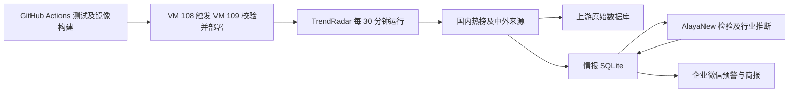

# TrendRadar 全球事件与 A 股行业情报

## 背景与方案概述

目标是在 PVE 以半小时为周期收集国内外资讯，及时提醒证据充分的重大事件，并汇总其他重点事件。趋势与影响分数用于筛选，交易和公司层面的数据验证留到后续阶段。

| 上游能力 | 处理 |
|---|---|
| RSS、热榜、原始 SQLite、Docker cron、渠道发送器 | 复用 |
| RSS 列表、模型地址、周期、阈值和渠道 | 通过配置扩展 |
| 目标源代理、官方 HTML 列表、来源状态 | 增加适配并沿用原生抓取器 |
| 跨语言事件、版本、行业推断、投递任务 | 独立 SQLite 和情报模块 |

上游 AI 支持批量分类、翻译和推送摘要。原有 RSS 索引按源和 URL/GUID 去重，原有推送记录按时段保存；事件和渠道投递需要跨天的状态。部署复用明利项目以镜像标识验证、健康检查和失败回退的做法。RSS 和正式公开政策页优先，Reuters、AP、FT 等待验证合规索引或授权接口。



## PVE 运行

在独立 Ubuntu 24.04 虚拟机安装 Docker、Compose v2、jq 和 curl。将 `deploy/pve/update.sh` 安装为 `/opt/trendradar/update.sh`，把示例环境文件安装为同目录内权限 0600 的 `runtime.env`。现有轮询定时器可用于过渡和回退。完成下文的直推验收后，日常发布由 CI 触发。

`runtime.env` 配置 `AI_API_BASE`、`AI_MODEL`、`AI_API_KEY` 和 `MARKET_WEWORK_WEBHOOK_URL`。通过 `MARKET_ANALYSIS_ENABLED` 和 `MARKET_NOTIFICATION_ENABLED` 分别启用。覆盖海外代理可设 `MARKET_INTERNATIONAL_PROXY`。只配海外代理时国内官方源仍直连。周期通过 `CRON_SCHEDULE` 调整。评分阈值、简报和分析额度在 `config/config.yaml` 的 `market_intelligence` 段配置，更新默认配置后由镜像发布生效。

```text
cd /opt/trendradar
sudo docker compose --env-file image.env exec -T trendradar python -m market_intelligence check-sources
sudo docker compose --env-file image.env exec -T trendradar python -m market_intelligence health
sudo docker compose --env-file image.env logs --since 1h trendradar
sudo journalctl -u trendradar-update.service
```

分析默认每轮最多 12 篇、每天最多 250 篇。每轮优先处理最近一小时的新资讯，给较早入库且仍在分析窗口内的文章保留约四分之一的额度。任何一队不足时，剩余额度供另一队使用。通过 `MARKET_MAX_ARTICLES_PER_RUN` 和 `MARKET_MAX_ARTICLES_PER_DAY` 可调整预算。

定时简报默认北京时间 21:30，最多 8 条。紧急提醒要求近 24 小时的官方报道并通过模型证据校验。只有标题的官方索引缺少精确发布时间时可进入简报，紧急提醒保持关闭。分数与出处写入 SQLite。若企微已接受请求后进程在落库前中断，机器人接口没有幂等键，此极短窗口可导致重发。

## 升级、回退与检查

同一时点只运行一个部署实例。下载慢时，在 VM 109 的 `/opt/trendradar/deploy-egress.env` 中配置 `export HTTPS_PROXY=...`。此文件由 root 管理且权限为 0600，供 CI 触发的更新脚本使用。首次部署已有相同归档时，可将其以权限 0600 放入 `/opt/trendradar/release-cache/<Release 标签>.tar.gz`，更新器以 GitHub Release 的 SHA-256 核对后复用。发布脚本只应用当前版本的后继提交，校验归档 SHA-256 与 Docker 镜像 ID，停止写入后备份配置和完整 SQLite 目录。保留当前和上一版镜像，以及最近五份且不超过 30 天的发布备份。失败恢复旧镜像和升级前数据。诊断时先检查发布日志，确认当前镜像 ID 和健康状态，再检查真实抓取结果。手工回退时先停更新定时器和容器，使用指定备份里的 compose 文件和 image.env。仅在数据格式确实需要回退时恢复 SQLite，并在恢复前备份现有数据，以免覆盖发布后新增的新闻或投递记录。

测试关注真实来源的 DNS、超时和响应变化，跨语言相似报道与不同事件，短时间恶化、模型格式错误、同一事件的官方确认、重复启动、通知失败和恢复，以及运行耗时和资源占用。定期记录至少 24 小时的来源健康。国内政策源需要维护列表规则。模型调用预算、真实渠道投递和发布故障恢复以现场验收为准。

## 从 GitHub Secrets 发布运行时配置

在 fork 的 Actions Repository secrets 设置 `MODEL_KEY` 和 `CHART_BOT`。后者接受企业微信群机器人 Webhook 或其 key。到 Actions 在 `master` 上手动运行 **Deploy PVE runtime configuration**。工作流使用 VM 的公开证书生成加密配置，独立的预发布 `pve-runtime` 存放密文。VM 的私钥留在 `/opt/trendradar/runtime-identity/private.pem`。更换 VM 时需要生成新证书、更新仓库中的公开证书并重新运行工作流。

CI 计算加密配置的 SHA-256 并直接调用 VM 109。更新器核对摘要，验证 AlayaNew Key 能读取模型列表且当前模型可用，再备份现有配置、替换环境文件并重建容器。健康检查成功后写出 `runtime.applied` 并返回摘要，失败则恢复原配置并让 CI 标记失败。通过生产定时任务观察企微投递。

手动发布默认使用 VM 108 的 `trendradar-runtime-pve` 仓库级 runner。长期服务只保留独立的 runner 注册状态，每个作业使用新的非特权容器。工作区不落到持久状态。GitHub 仓库设置为所有外部贡献者的 PR 工作流都需批准。

在 CI 虚拟机上用 `systemctl status trendradar-ci-runner.service` 查看 runner。首次安装时，将 `ci-runner.sh` 安装到 `/opt/trendradar-ci/`，安装同目录的 systemd 单元，预拉取脚本中指定版本的官方 runner 镜像。通过标准输入传入本仓库的短期注册令牌执行脚本的 `register` 子命令，再启用服务。升级 runner 版本时更新脚本中的镜像并拉取，然后重启 TrendRadar runner 单元。部署 VM 的配置应用状态见 `trendradar-runtime.service`。


## GitHub CI 直推与验收

合并 `master` 后，托管 runner 测试并发布 SHA 对应镜像，VM 108 上的 TrendRadar runner 触发 VM 109 部署。CI 等待容器通过健康检查和 VM 写入 `image.applied`。失败时可以在 Actions 下载部署 job 日志。获取 VM 上的回执只需查看 `/opt/trendradar/image.applied` 和 `/opt/trendradar/runtime.applied`。

- 在 GitHub 创建 `trendradar-pve` 环境，允许 `master` 分支。将部署专用 SSH 私钥设为环境 Secret `PVE_DEPLOY_KEY`，将通过受信渠道确认的 VM 109 SSH 主机公钥设为环境变量 `PVE_DEPLOY_KNOWN_HOSTS`，内容采用 OpenSSH known_hosts 单行格式。现有 `MODEL_KEY` 和 `CHART_BOT` 用于配置发布。
- 在 VM 109 备份现有部署脚本。以 root 安装 `update.sh` 和 `runtime-update.sh` 到 `/opt/trendradar/`，权限 0700。将 `deploy-request.sh` 安装到 `/usr/local/libexec/trendradar-deploy-request`，权限 0755。用 `visudo -cf` 验证 `trendradar-deploy.sudoers` 后安装到 `/etc/sudoers.d/trendradar-deploy`，权限 0440。部署账号 `trendradar-deploy` 的家目录和 SSH 配置由 root 持有，授权公钥添加 `from="192.168.0.100",restrict,command="/usr/local/libexec/trendradar-deploy-request"`，可执行的请求只有指定 SHA 的镜像或指定摘要的配置。
- 在 VM 108 备份并更新 TrendRadar runner 的 `ci-runner.sh`，检查它只额外放通到 `192.168.0.103:22`，再重启 TrendRadar 专用服务。外部 PR 继续使用托管 runner，并保留外部贡献者工作流审批。
- 等 GitHub 创建作业后，暂停两个 VM 109 更新定时器，再用合并触发的镜像发布和手动触发的配置发布分别验收。对照 GitHub job 日志、VM 回执和容器健康，确认后执行 `systemctl disable --now trendradar-update.timer trendradar-runtime.timer`。验收失败先恢复原定时器。容器内半小时新闻任务独立运行。
- Web 报告在 VM 109 的内网网卡开放 80 和 8080 端口。可以通过 `http://192.168.0.103:8080/` 访问，内网可访问 `http://tr.yumy.space/`。
- Actions 显示排队且作业列表为空时，先查 GitHub 调度状态。发生持续 0 个 job 且取消返回 HTTP 409 时，记录运行链接并按 GitHub Actions 排障说明联系支持。

## 私有部署仓库

源码和 PR 保留在公开 fork。私有仓库 `ymygogogo/trendradar-ci` 按计划或手动检查源码 `master` 的提交。目标 SHA 已运行时跳过构建。否则托管 runner 用该 SHA 构建、测试并生成 Actions 制品，VM 108 的 `trendradar-private-pve` runner 从私有 workflow 下载制品并经受限 SSH 发送到 VM 109。部署 job 核对 VM 实际运行 SHA。配置 workflow 单独将加密后的配置经 SSH 送入 VM 109，每次核对密文摘要与容器健康。正式切换后，两条轮询定时器可以关闭。

VM 109 的受限 SSH 入口使用 `status`、`image-artifact <SHA>` 和 `runtime-artifact <SHA256>` 子命令。以 root 安装 `read-artifact.py` 到 `/opt/trendradar/`，更新两份部署脚本、SSH 强制命令脚本和 sudoers。VM 108 继续与已有明利 runner 隔离，使用独立的注册状态与服务 `trendradar-private-ci-runner.service`。私有仓库的 `pve` 环境仅允许 `main`，保存部署 SSH 密钥、VM 公钥和运行配置所需 Secret。

PVE 默认通过 `MARKET_FOCUSED_CRAWL` 仅拉取财经和政策配置里的热榜与 RSS。泛热榜和辅助资讯不发请求，财经媒体条目命中 `ignore_title_terms` 时在写入 SQLite 前跳过。官方政策源不受娱乐标题词过滤。已归档的原始数据保留，历史报告按当前启用的平台范围读取。

## 交易日简报

交易时段由 `market_intelligence.digest.trading_times` 配置，默认北京时间 08:30、11:35 和 15:30。容器使用现有 Supercronic 调度，在配置的分钟尝试，并在同一时段内重试。时段开始前已入库的有效分析结果可进入简报。08:30 使用最近 12 小时的事件，午间和收盘按前一交易简报时段后的进展选取，晚间 21:30 简报保持原有行为。

交易日历来自上交所年度休市公告，维护于 `config/cn_trading_calendar.yaml`。补班周末仍休市。会在缺少已验证日历的年份跳过交易简报并写日志。跨年前根据交易所公告更新日历并随镜像部署。

## 管理入口

PVE 配置将管理服务单独发布到 VM109 的 HTTPS 443 端口。管理页为 `https://tr.yumy.space/admin/`，以 `admin` 登录。新闻报告仍在 HTTP 80 和 8080。管理服务支持媒体标题过滤词、AI 分析预算、评分阈值和简报条数，保存后从下一轮任务读取。交易时段和来源清单由仓库配置管理。

镜像部署前，在 VM109 准备 `/opt/trendradar/admin-state` 与 `/opt/trendradar/admin-private`，仅允许运行管理服务的 UID 10001 访问。私有目录存放 HTTPS 证书、VM 私钥及管理密码哈希。采集容器只读挂载设置目录，静态报告目录不包含这些文件。管理登录失败、表单校验失败或跨站提交不会修改设置。

如需换密码，在 VM109 通过以下命令交互操作。密码文件为持久化状态，重启后仍有效。

```text
cd /opt/trendradar
image=$(sed -n 's/^TREND_IMAGE=//p' image.env)
docker run --rm -it --user 10001:10001 \
  -v "$PWD/admin-private:/app/admin-private" \
  --entrypoint python "$image" -m market_intelligence.admin set-password
```

## 上市公司业务关联

`config/market_companies.yaml` 维护已核验的上市公司主营业务、具体产业环节和第一方证据。新事件经结构化校验后，由程序将具体板块与证据表精确关联。只有证据表中明确支持的发行人才会随事件输出。当前目录覆盖半导体设备、晶圆代工、动力和储能电池行业的四家公司。公开业务关联反映产业位置，实际事件敞口和股价反应仍需另行验证。

周日 20:30 北京时间向现有渠道发送下周财经事件日历。它使用配置中的已核验发布资料，将发布方时区换算为北京时间。第一版覆盖部分国家统计局、美联储和美国劳工统计局发布日程，维护 `config/market_events_calendar.yaml` 并更新覆盖期限。没有已收录事件或覆盖不足时只写日志。当天分钟及其后 5、10 分钟尝试，同一周重启后仍按渠道去重。

收盘对照使用上交所官网公开的日终重点指数快照。默认记录上证指数、科创综指和科创 50 的收盘与成交额。只有找到经交易所日历确认的上一交易日快照时才计算日涨跌幅。同日指数观测单独列出，事件影响仍由资讯分析表达。数据仅供内网非商业使用，来源见 [上交所重点指数](https://www.sse.com.cn/market/sseindex/overview/) 和 [上交所使用说明](https://www.sse.com.cn/home/legal/)。

管理页总览展示当前数据库中的待分析、已分析、重点事件和成功投递数，并列出过去 24 小时最近报道的至多 8 条 P0 / P1 事件。采集渠道展示 RSS 来源类别、成功次数、抓取耗时、最近成功时间和最新文章时间。推送渠道展示实际启用状态、缺少凭据的渠道、最近投递结果和成功及失败记录数。定时简报运行和采集结束后都会更新快照，页面时间统一显示为北京时间。

Prometheus 可通过管理员身份抓取 `https://tr.yumy.space/admin/metrics`。指标覆盖新闻处理状态、事件等级、投递状态及各 RSS 源抓取次数、成功次数、连续失败次数和最近耗时。用 `trendradar_status_snapshot_timestamp_seconds` 判断状态快照的时效。管理服务只读挂载独立的状态快照。采集日志、源 URL 和凭据留在采集侧，事件摘要仅出现在需要登录的管理页。
